

  <picture>
    <source media="(prefers-color-scheme: dark)" srcset="assets/static/banner-dark.svg">
    
  </picture>

  <picture>
    <source media="(prefers-color-scheme: dark)" srcset="https://readme-typing-svg.demolab.com?font=Orbitron&amp;weight=600&amp;size=22&amp;duration=3500&amp;pause=1200&amp;color=00D4FF&amp;center=true&amp;vCenter=true&amp;width=760&amp;height=50&amp;lines=Full-Stack+Developer;Building+web+apps+with+.NET%2C+React+%26+Node;Rocket+League+content+creator;Always+shipping%2C+always+boosting+%F0%9F%9A%80">
    
  </picture>

## ⚡ About me

<!-- ALT:scoreboard:START --><!-- ALT:scoreboard:END -->

👋 Hi! I'm **Luis Ángel Jose Da Silva**, a **Software Developer** and **Rocket League content creator**.

- 💻 I build **web applications** end to end, combining **frontend, backend and databases** to bring ideas to life.
- 🎓 I finished my studies in **Web Application Development (DAW)** and keep leveling up with personal projects.
- 🎮 On YouTube I'm [**@lk_rl**](https://youtube.com/@lk_rl): **Rocket League** content that helps players learn and improve.
- 🤖 I experiment with **AI tools** to sharpen my coding workflow and productivity.
- 🤝 Always open to **collaborations** and new challenges. Let's build something cool!

## 🚀 Projects

  <a href="https://www.magnarwargames.com/"></a>
  <a href="https://github.com/luigikings/ChatarreroMetalRenova"></a>
  <a href="https://github.com/luigikings/AgencyMac"></a>
  <a href="https://github.com/luigikings/ChefAsesoriaJ"></a>
  <a href="https://youtube.com/@lk_rl"></a>

## 🛠️ Tech stack

  

<b>🌐 Frontend</b>

HTML5 · CSS3 · JavaScript · TypeScript · React · TailwindCSS

<b>⚙️ Backend</b>

Node.js · Django · .NET · PHP

<b>🗄️ Databases</b>

MySQL · MariaDB · MongoDB

<b>💻 Programming Languages</b>

Java · Python · C · C# · Kotlin

<b>🧰 Tools &amp; DevOps</b>

Git · Docker · Linux · AWS · Azure

## 📊 GitHub stats

  <!-- ALT:stats:START --><!-- ALT:stats:END -->
  <!-- ALT:languages:START --><!-- ALT:languages:END -->
  <!-- ALT:streak:START --><!-- ALT:streak:END -->

  <picture>
    <source media="(prefers-color-scheme: dark)" srcset="assets/generated/snake-dark.svg">
    
  </picture>

  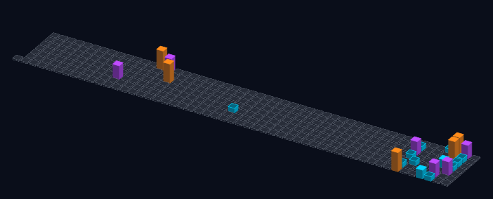

## 🎬 Latest YouTube videos

<!-- YOUTUBE:START -->

  

  Rocket League gameplay, tips and tutorials to help you rank up. 
  <a href="https://youtube.com/@lk_rl">More videos on the channel →</a>

<!-- YOUTUBE:END -->

## 📫 Contact

  
  
  

  Open to collaborations. Drop me a line at <a href="mailto:luigidasilv@gmail.com">luigidasilv@gmail.com</a>.

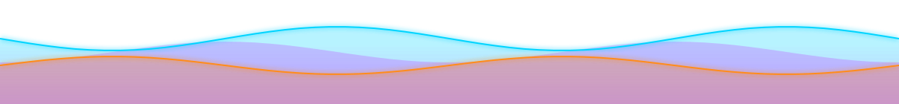

